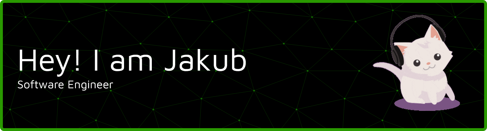

  

<h3 align="center">A problem solver, data science learner, and a student from Poland</h3>

   

  

  
  

## My Skill Set  
<table><tr><td valign="top" width="33%">

### Frontend  

  
  
  
  
  
  
  
  

</td><td valign="top" width="33%">

### Backend  

  
<!-- Languages -->
  
 
  
  
  
  
  
<!-- Frameworks & Runtime -->
   
  
  
  
  
<!-- Databases & Servers -->
  
  

</td><td valign="top" width="33%">

### Dev Ops / ML / Other  

  
<!-- DevOps -->
  
  
  
  
  
<!-- ML -->
  
  
  
  
  
<!-- Other -->
  
  
  
  
  

</td></tr></table>  
